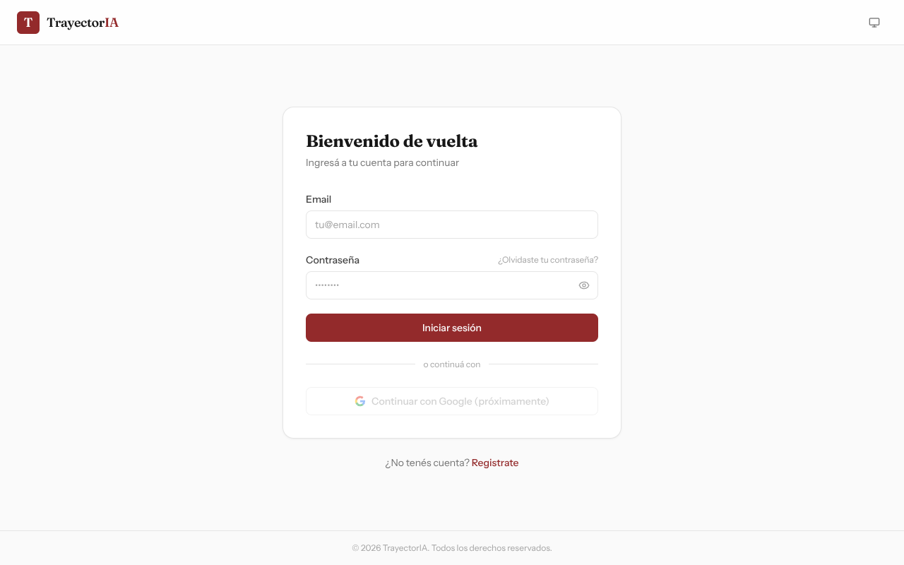

# Design system

The UI is built from a small set of tokens and primitives. The rule of thumb: **if a pattern appears twice, it
belongs in a token or a component, not in a copied class string.**

| Light | Dark |
|---|---|
|  |  |

## Colour

Everything is defined in `src/app/globals.css`.

**Brand: burgundy `#932A2B`.** The scale is generated in OKLCH and step `600` is exactly `#932A2B`.

| Step | 50 | 100 | 200 | 300 | 400 | 500 | **600** | 700 | 800 | 900 |
|---|---|---|---|---|---|---|---|---|---|---|
| Hex | `#FFF4F3` | `#FEE7E4` | `#FACDC8` | `#F5A6A0` | `#E67A74` | `#C84746` | **`#932A2B`** | `#762222` | `#5A1919` | `#3D1110` |

`#932A2B` is 8:1 on white but only ~2.3:1 on dark surfaces, so the dark theme lifts the brand: fills use `500`
(white text 4.7:1) and text/links use `400` (6.3:1 on the card).

**Neutrals are achromatic** (no warm or cool cast), for a calm, sober background in both themes:
`#FAFAFA` page / `#FFFFFF` card in light, `#0A0A0A` page / `#171717` card in dark.

**Status colours** come from the brand's neighbours on the colour wheel: teal-green *success* (near its
complement), amber *warning* (analogous), and a vivid red-orange *danger* that stays clearly distinct from the
burgundy brand.

### Semantic tokens: use these, not shades

Components never pair a light and a dark shade by hand. They use semantic classes that flip with the `.dark` class:

| Class | Use |
|---|---|
| `bg-background` `bg-card` `bg-muted` `bg-raised` `bg-hover` | surfaces |
| `text-foreground` `text-secondary-foreground` `text-body` `text-muted-foreground` `text-subtle` `text-faint` | text, from strongest to faintest |
| `border-border` `border-border-soft` `border-input` | borders |
| `bg-primary` `hover:bg-primary/90` `text-brand-text` | brand fills and brand-coloured text |
| `bg-brand-tint` `bg-brand-tint-strong` `bg-danger-tint` | soft tinted surfaces |

## Typography

Fraunces (variable serif) for `h1`-`h3`, Instrument Sans for everything else. Headings pick the display face
from one base rule; there is no per-component font class.

## Primitives

| Need | Use |
|---|---|
| Button | `ui/button` (`Button`, `buttonVariants`) |
| Text field / textarea / native select | `ui/input`, `ui/textarea`, `ui/native-select` |
| Label and validation message | `shared/forms/FormField` (`FormLabel`, `FieldError`) |
| Status chips | `shared/data/StatusBadge` (`ApplicationStatusBadge`, `JobStatusBadge`, `RecommendationBadge`), driven by the `*_TONE` maps in `config/constants.ts` |
| Generic chip | `ui/badge` (variants: `brand` `neutral` `success` `warning` `danger`) |
| Loading | `ui/spinner` (inline), `ui/skeleton` (placeholders) |
| Dialog, side sheet, bottom sheet | `shared/overlays/Modal` (Radix Dialog: focus trap, Esc, `role="dialog"`) |
| Logo / decorative icon square | `shared/brand/Logo`, `shared/brand/IconTile` |

## Conventions

- No hard-coded colours (`#hex`, `rgb()`, inline `style={{ background }}`) and no gradients. Use tokens.
- No raw `dark:` colour pairs. If a new light/dark pair is needed twice, add a semantic token.
- Icons describe the domain (a document for CVs, messages for interviews). There is no "AI sparkle" iconography.
- Internal navigation uses `next/link`.
- Route groups: `(public)`, `(candidate)`, `(company)` and `(workspace)`; the last one hosts the full-height
  split-panel pages (`/jobs`, `/saved`, `/ai/*`) with a single shared layout.

## Checks

```bash
npx tsc --noEmit      # strict types, no unused locals/imports
npm run lint          # eslint-config-next + type-import / no-any rules
npm run build
```
