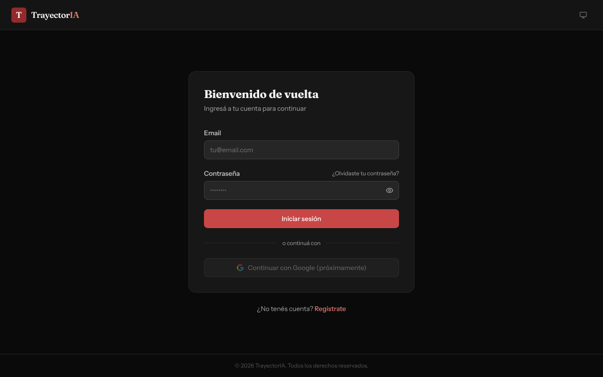

# Design system

The UI is built from a small set of tokens and primitives. The rule of thumb: **if a pattern appears twice, it
belongs in a token or a component, not in a copied class string.**

| Light | Dark |
|---|---|
|  |  |

## Colour

All colour lives in one file, `src/styles/tokens.css`. Components never reference it directly; they use the
semantic Tailwind classes described below.

### Brand: burgundy `#932A2B`

Step `600` is exactly `#932A2B`; the rest of the scale is built around it and stays within hue 359°–7°
(red to red-orange). There is no violet, purple or indigo anywhere.

| Step | 50 | 100 | 200 | 300 | 400 | 500 | **600** | 700 | 800 | 900 |
|---|---|---|---|---|---|---|---|---|---|---|
| Hex | `#FFF4F3` | `#FEE7E4` | `#FACDC8` | `#F5A6A0` | `#E67A74` | `#C84746` | **`#932A2B`** | `#762222` | `#5A1919` | `#3D1110` |

`#932A2B` is 8.1:1 on white but only about 2.3:1 on dark surfaces, so the dark theme lifts the brand: fills use
`500` (white text 4.7:1) and text and links use `400` (6.3:1 on the card).

### Neutrals are achromatic

Every neutral step has R = G = B, so there is no warm or cool cast and the background stays calm in both themes:

| | Page | Card | Muted / input |
|---|---|---|---|
| Light | `#FAFAFA` | `#FFFFFF` | `#F5F5F5` / `#FFFFFF` |
| Dark | `#0A0A0A` | `#171717` | `#262626` / `#262626` |

### Status colours

Chosen as neighbours of the brand on the colour wheel, with the error deliberately turned away from the burgundy:

| Status | Hue | Light text | Dark text | Note |
|---|---|---|---|---|
| Success | ~157° teal-green | `success-700` | `success-400` | |
| Warning | ~38° amber | `warning-700` | `warning-400` | |
| Danger | ~16° vermilion | `danger-600` `#C4400F` | `danger-400` `#F97F4F` | 16° from the brand's 359° plus a clear jump in lightness and saturation; in dark mode ΔE 25 from the brand text (it was 17 with the previous red) |

Colour is never the only signal: errors carry an icon (`ErrorAlert`), statuses carry a text label.

### Semantic tokens: use these, not shades

Components never pair a light and a dark shade by hand. The `.dark` class flips the token values, so a component
written once is correct in both themes.

| Class | Use |
|---|---|
| `bg-background` `bg-card` `bg-muted` `bg-raised` `bg-hover` | surfaces (page, card, quiet panel, input/popover, row hover) |
| `text-foreground` `text-secondary-foreground` `text-body` `text-muted-foreground` `text-subtle` | text, strongest to weakest; **every step is at least 4.5:1** on card, page and muted surfaces |
| `text-faint` | decorative icons only (below AA, never for text) |
| `border-border` `border-border-soft` | decorative dividers and card edges |
| `border-input` | the boundary of a form control; **3:1** against its surface (WCAG 1.4.11) |
| `bg-primary` `text-primary-foreground` `text-brand-text` `ring-ring` | brand fills, text on them, brand-coloured text, focus ring |
| `bg-brand-tint` `bg-brand-tint-strong` `border-brand-border` | soft brand surfaces and outlines |
| `bg-danger-tint` `text-danger-text` `border-danger-border` `bg-destructive` | errors; `destructive` is the fill (white text), `danger-text` is for text |
| `bg-success-tint` `text-success-text` `bg-success` | success; `bg-success` is for dots and bars |
| `bg-warning-tint` `text-warning-text` `bg-warning` | warning, same split |
| `bg-scrim` | modal backdrop |

Why two names for the same hue (`destructive` vs `danger-text`)? A fill needs enough contrast against the white
label on it, text needs enough contrast against the surface behind it; in dark mode those are different shades.

### Contrast is enforced, not assumed

```bash
python3 scripts/check-contrast.py
```

reads the tokens from `tokens.css`, resolves both themes (including the translucent tints) and checks 26 pairs:
text against its real backgrounds at 4.5:1, focus ring and input borders at 3:1. It exits non-zero on any failure,
so run it after touching `tokens.css`. Current results, light / dark:

| Pair | Light | Dark |
|---|---|---|
| secondary text on card | 7.8 | 7.1 |
| hint / placeholder on card | 4.7 | 7.1 |
| text on brand button | 8.1 | 4.7 |
| brand text on card | 8.1 | 6.3 |
| error text on card | 5.1 | 7.0 |
| success text on card | 7.0 | 8.2 |
| warning text on card | 7.0 | 9.4 |
| input border vs card | 4.7 | 3.8 |
| focus ring vs page | 4.5 | 7.0 |

## Typography

Fraunces (variable serif) for `h1`-`h3`, Instrument Sans for everything else. Headings pick the display face from
one base rule in `globals.css`; there is no per-component font class. Labels are sentence case; there are no
all-caps tracking labels.

## Building blocks

### Primitives (`components/ui`)

| Need | Use |
|---|---|
| Button, link styled as a button | `Button` (`variant`, `size`, `loading`, `asChild`) |
| Card surface | `Card` (`padding`: `none` `sm` `md` `lg` `xl`; `interactive`; `asChild`) |
| Text field, textarea, native select, checkbox | `Input`, `Textarea`, `NativeSelect`, `Checkbox` |
| Error banner | `ErrorAlert` (`role="alert"` + icon) |
| Chip | `Badge` (`neutral` `brand` `success` `warning` `danger`) |
| Menu | `DropdownMenu*` (Radix: arrow keys, typeahead, Esc, focus return) |
| Loading | `Spinner` (inline), `Skeleton`, `SkeletonLines` (placeholders) |

### Shared components (`components/shared`)

| Need | Use |
|---|---|
| Label + control + hint/error, correctly associated | `forms/Field` (render prop; supplies `id`, `aria-invalid`, `aria-describedby`) |
| Field + Input/Textarea + `register` in one tag | `forms/TextField`, `forms/TextareaField` (inside a `FormProvider`) |
| Password with show/hide | `forms/PasswordInput` |
| Dialog, side sheet, bottom sheet | `overlays/Modal` (focus trap, Esc, `role="dialog"`) |
| Status chip / dot / change-status menu | `data/StatusBadge` (+ `StatusDot`), `data/StatusMenu`; driven by the `*_TONE` maps in `config/constants.ts` |
| Photo or initials, with upload | `data/Avatar`, `data/AvatarUpload` |
| Sidebar, shell, bottom bar | `layout/Sidebar`, `layout/AppShell`, `layout/MobileBottomNav`; routes come from `config/navigation.ts` |
| List + detail with mobile back button | `layout/MasterDetail`, `layout/DetailPlaceholder` |
| Page title row | `layout/PageHeader` |
| Empty state, page/card/form/job skeletons | `feedback/EmptyState`, `feedback/PageSkeleton` (`CardSkeleton`, `FormSkeleton`, `JobCardSkeleton`) |
| Logo, decorative icon square, Google "G" | `brand/Logo`, `brand/IconTile`, `brand/GoogleIcon` |

`GoogleIcon` is the only place with hex colours: they are mandated by Google's brand guidelines, not part of our
palette.

### Forms, the short version

```tsx
const form = useForm<Values>({ resolver: zodResolver(schema) })

<FormProvider {...form}>
  <form onSubmit={form.handleSubmit(onSubmit)} noValidate>
    <TextField<Values> name="email" label="Email" type="email" />
    <Field label="Nivel" error={errors.level?.message}>
      {(a11y) => <NativeSelect {...a11y} {...register('level')}>…</NativeSelect>}
    </Field>
    <Button type="submit" loading={isPending}>Guardar</Button>
  </form>
</FormProvider>
```

## Conventions

- No hard-coded colours (`#hex`, `rgb()`, inline `style`) and no gradients. Use tokens. There are no inline styles.
- No raw palette steps (`neutral-500`, `brand-700`) and no `dark:` colour pairs in components. If a new
  light/dark pair is needed, add a semantic token to `tokens.css` and re-run the contrast check.
- Icons describe the domain (a document for CVs, messages for interviews, a building for companies). There is no
  "AI sparkle" iconography, no "powered by AI" badge and no emoji as decoration.
- Internal navigation uses `next/link`. A full `window.location` navigation is used only where it is the point
  (the 401 interceptor, to drop all session state).
- One place for each helper: routes in `config/routes.ts`, navigation in `config/navigation.ts`, enums' labels and
  tones in `config/constants.ts`, formatters in `lib/utils`.
- Feature code lives in `features/<feature>/{components,hooks,schemas,types}`. A file that grows past ~250 lines is
  split by responsibility (see `features/company/components/offer-form/`).
- Route groups: `(public)`, `(candidate)`, `(company)` and `(workspace)`; the last hosts the full-height
  split-panel pages (`/jobs`, `/saved`, `/ai/*`).
- Comments explain *why* (a constraint, a trade-off), not what the code already says.

## Accessibility

- Visible focus on every control (`:focus-visible` uses the `ring` token, 4.5:1 or better on both themes).
- Dialogs and sheets use `Modal` (Radix Dialog): focus is trapped, Esc closes, focus returns to the trigger.
- Every control has an accessible name: `Field` associates labels, icon-only buttons have an `aria-label`.
- Validation messages are `role="alert"`, linked to their field with `aria-describedby`, with `aria-invalid` set.
- Navigation landmarks are labelled; the active link has `aria-current="page"`; selectable rows use
  `aria-pressed` / `aria-current`; the interview conversation is a `role="log"`.
- Row actions that appear on hover are also shown on keyboard focus, and always on touch screens.
- Contrast: AA in both themes, enforced by `scripts/check-contrast.py`.

## Checks

```bash
npx tsc --noEmit                      # strict types, no unused locals/imports
npm run lint                          # eslint-config-next, zero warnings
npm run build
python3 scripts/check-contrast.py     # WCAG AA for every token pair, both themes
```
